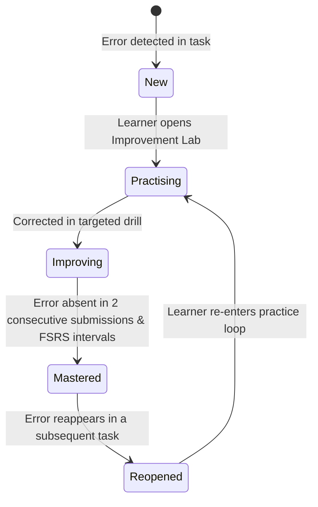

# LexiFlow AI — Architecture Specification (ARCHITECTURE.md)

**Product:** One Learning System, Two Exam Engines (PTE Academic + IELTS Academic)  
**Version:** 1.1 (Production Blueprint)  
**Status:** Approved  

---

## 1. 4-Layer System Architecture

LexiFlow AI is built on a clean, decoupled 4-layer architecture running on a zero-idle-cost edge cloud.

```
┌────────────────────────────────────────────────────────────────────────┐
│                      LAYER 1: PRESENTATION LAYER                       │
│  - React 19 Mobile-Responsive Web Application (Vite / Tailwind / CSS)  │
│  - Onboarding Flow (Exam target, date, mother tongue)                  │
│  - Writing Editor (Autosave, live word count, timer, exam/learn mode)  │
│  - Audio Engine (HTML5 MediaRecorder, Opus/WebM mobile audio stream)   │
│  - Mistake Memory & Improvement Lab Dashboard                          │
└───────────────────────────────────┬────────────────────────────────────┘
                                    │ HTTPS / REST (Bearer JWT)
                                    ▼
┌────────────────────────────────────────────────────────────────────────┐
│                   LAYER 2: APPLICATION & API GATEWAY                   │
│  - Cloudflare Workers + Hono REST API (api.lexiflow.app)               │
│  - Authentication & JWT Session Verification                           │
│  - Atomic Rate Limiting & User Daily Quotas                            │
│  - Usage & Cost Audit Logging (UsageRecord)                            │
│  - Deterministic Pre-Evaluation Gate (Word count, time, regex checks)  │
└───────────────────────────────────┬────────────────────────────────────┘
                                    │
                  ┌─────────────────┴─────────────────┐
                  ▼                                   ▼
┌───────────────────────────────────┐ ┌──────────────────────────────────┐
│      LAYER 3A: LEARNING CORE      │ │     LAYER 3B: EXAM ENGINES       │
│ - Mistake Memory State Machine    │ │ - PTE Engine (exams/pte/)        │
│   (New -> Practising -> Mastered) │ │   * 22 Scored Tasks + 1 Unscored │
│ - Error Taxonomy Loader (v1)      │ │   * Machine Scoring Adapters     │
│ - FSRS Spaced Repetition Engine   │ │ - IELTS Engine (exams/ielts/)    │
│ - AI Provider Abstraction Layer   │ │   * Writing (Tasks 1 & 2)        │
│   (Gemini, Claude, OpenAI, Mock)  │ │   * Speaking (Parts 1, 2, 3)     │
│ - Zod Runtime Schema Validation   │ │   * Reading & Listening Tasks    │
└─────────────────┬─────────────────┘ └──────────────────┬───────────────┘
                  │                                      │
                  └──────────────────┬───────────────────┘
                                     │
                                     ▼
┌────────────────────────────────────────────────────────────────────────┐
│                     LAYER 4: PERSISTENCE & STORAGE                     │
│  - Cloudflare D1 (ACID SQLite at Edge): Staged relational tables       │
│  - Cloudflare R2 (Object Storage): Learner audio files (90-day TTL)    │
│  - Cloudflare KV: Cached definitions, prompt templates & static assets │
└────────────────────────────────────────────────────────────────────────┘
```

---

## 2. Dependency Rules & Boundaries (Inflexible Constraints)

To prevent architectural decay and tangled dependencies:
1. **Unidirectional Flow:**
   - Layer 1 (Presentation) can only communicate with Layer 2 (API Gateway) via HTTPS/REST.
   - Layer 2 delegates to Layer 3 (Learning Core & Exam Engines).
   - Layer 3 coordinates with Layer 4 (Persistence).
   - Layer 4 never calls higher layers.
2. **Exam Engine Isolation:**
   - `exams/pte/` and `exams/ielts/` are strictly isolated from one another.
   - PTE code must NEVER import from or reference `exams/ielts/`.
   - IELTS code must NEVER import from or reference `exams/pte/`.
   - Both engines depend solely on the shared `Learning Core` (`MistakeMemory`, `ErrorTaxonomy`, `AIProvider`).
   - *CI rule:* Any PR touching both directories simultaneously will fail automated checks.
3. **Deterministic First Rule:**
   - LLMs are never invoked for calculations that can be performed deterministically (e.g., word count, timer expiration, empty text rejection, regex format checking).
4. **Zod Schema Boundary:**
   - Raw LLM string responses are NEVER passed downstream. Every response is validated against Zod schemas. If parsing fails, the system executes an automated retry or marks the evaluation as `UNCERTAIN`.

---

## 3. Directory & Monorepo Structure

```text
lexiflow/
├── .github/
│   └── workflows/ci.yml         # Automated Lint, Types, Unit & CI Path checks
├── docs/                        # Architecture diagrams & calibration reports
├── exams/
│   ├── pte/
│   │   ├── config/
│   │   │   └── inventory.yaml   # 22 scored tasks + 1 unscored metadata
│   │   ├── adapters/            # PTE-specific scoring traits & logic
│   │   └── rubrics/             # Pearson trait prompt templates
│   └── ielts/
│       ├── config/
│       │   └── inventory.yaml   # Writing, Speaking, Reading, Listening metadata
│       ├── adapters/            # IELTS band calculation adapters
│       └── rubrics/             # Official band descriptor prompt templates
├── taxonomy/
│   └── errors.yaml              # Error Taxonomy v1 (25-40 error codes)
├── server/                      # Layer 2 & Layer 4: Cloudflare Workers backend
│   ├── migrations/              # Staged SQL schema migrations
│   │   ├── 0001_phase0_core.sql # Users, LearnerProfile, MistakeMemory, etc.
│   │   └── ...
│   ├── src/
│   │   ├── index.ts             # Hono app entry point
│   │   ├── routes/              # Auth, evaluation, practice, mistake routes
│   │   ├── middleware/          # JWT auth, rate-limit, audit logging
│   │   └── lib/                 # Database helpers, R2 audio client
│   ├── wrangler.toml            # Cloudflare worker & binding configuration
│   └── package.json
├── src/                         # Layer 1 & Layer 3: Shared Core & Web Frontend
│   ├── services/
│   │   ├── ai/                  # Multi-provider AI abstraction & Zod schemas
│   │   ├── fsrs/                # FSRS Spaced repetition engine
│   │   ├── mistake/             # Mistake Memory state machine
│   │   └── audio/               # Mobile audio recording & streaming client
│   ├── components/              # Reusable React UI components
│   ├── views/                   # Onboarding, Dashboard, Editor, Review views
│   └── types/                   # Shared TypeScript interfaces
├── PRODUCT.md                   # Product vision, scope & non-goals
├── ARCHITECTURE.md              # 4-layer architecture & dependency rules
├── AGENTS.md                    # Coding rules & restrictions for agents
├── DEFINITION_OF_DONE.md        # 8 criteria required for every PR
├── DECISIONS.md                 # Architecture Decision Records (ADRs)
└── package.json                 # Monorepo root workspace configuration
```

---

## 4. Mistake Memory State Machine

Every identified error from learner responses transitions through a strict state machine:



- **Retention & Scheduling:** When an error enters `Improving`, FSRS generates review checkpoints at 1, 3, 7, and 21 days.
- **Auditability:** Every state transition logs: `errorOccurrenceId`, `sourceTaskId`, `evaluatorVersion`, `timestamp`.

---

## 5. Security, Secrets & Privacy

1. **Zero Client Secrets:** No OpenAI, Gemini, or Claude API keys are ever stored on or transmitted to the client. Keys live strictly in Cloudflare Worker encrypted secrets.
2. **Audio Data Privacy:** Audio files in Cloudflare R2 have an automated 90-day lifecycle expiration. Immediate data wipe is supported via user settings.
3. **Audit Trail:** Every AI call records tokens, costs, and versions in `UsageRecord` to prevent runaway cloud bills.
