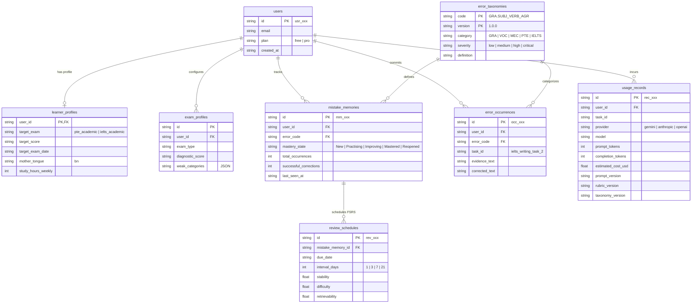

# LexiFlow AI — Database Architecture & ERD (Phase 0 Foundation)

**Target:** Cloudflare D1 (Serverless SQLite at the edge)  
**Schema Version:** 0004_phase0_foundation.sql  
**Status:** Approved  

---

## 1. Entity Relationship Diagram (ERD)

---

## 2. Staging Strategy for Future Phases

- **Phase 1 (Writing):**
  - Add `questions` (prompt, rubrics, task_type).
  - Add `responses` (learner essay text, word_count, time_spent_seconds).
  - Add `evaluations` (score_range, confidence, evidence_json, model_version).
  - Add `content_assets` (sample band 8 essays, annotated model responses).

- **Phase 2 (Speaking):**
  - Add `recordings` (audio_url in R2, mime_type, duration_seconds, sample_rate, size_bytes).
  - Add `transcripts` (raw text, confidence).
  - Add `timestamps` (word-level start/end ms offsets).
  - Add `pronunciations` (phoneme scores, acoustic fluency, pause duration metrics).

- **Phase 3 (Reading & Listening):**
  - Add `answer_keys` (deterministic values, accepted variations, partial credit rules).
  - Add `scoring_records` (item-level right/wrong, time_taken).

- **Phase 4 (Validation & Monetization):**
  - Add `subscriptions` (provider, tier, status, period_end).
  - Add `billing` (invoices, transaction logs).
